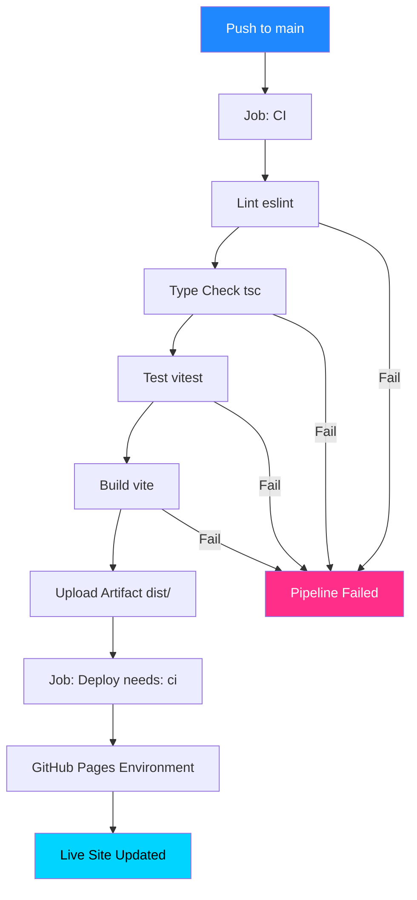
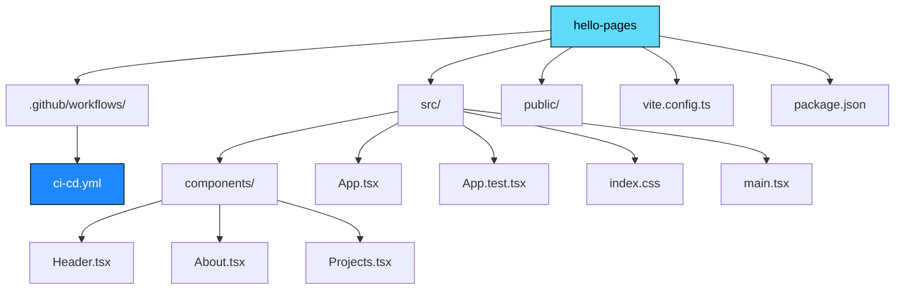

# 🚀 Hello Pages · React SPA

<p align="center">
  <b>Одностраничное приложение (SPA) на React + TypeScript с настоящим CI/CD на GitHub Pages</b>
</p>

<p align="center">
  <a href="https://chrisredfield48.github.io/hello-pages/">
    
  </a>
  
  
  
  
</p>

---

## 🔗 Ссылки

- 🌐 **Живой сайт:** [https://chrisredfield48.github.io/hello-pages/](https://chrisredfield48.github.io/hello-pages/)
- 🚀 **Deployments:** [История развёртываний](https://github.com/ChrisRedfield48/hello-pages/deployments)
- ⚙️ **Environments:** [Настройки окружения](https://github.com/ChrisRedfield48/hello-pages/settings/environments)

---

## ✨ О проекте

**Hello Pages** — это учебный React-проект, созданный для отработки навыков настройки **настоящего Continuous Deployment (CD)**. 

В отличие от простых статических сайтов, здесь код проходит полноценный цикл проверки: линтинг, проверку типов (TypeScript), unit-тесты и production-сборку. И только если **все проверки пройдены успешно**, проект деплоится на GitHub Pages.

### 🖼 Скриншот сайта


*(Замените этот путь на свой скриншот, если добавите его в папку `docs/`)*

---

## 🛠 Технологический стек

| Технология | Роль |
|---|---|
| **React 18** | Библиотека для построения пользовательских интерфейсов |
| **TypeScript** | Статическая типизация для безопасного кода |
| **Vite** | Современный и быстрый сборщик фронтенда |
| **Vitest** | Фреймворк для юнит-тестирования |
| **ESLint** | Линтер для поиска проблем в коде |
| **GitHub Actions** | CI/CD пайплайн |
| **GitHub Pages** | Хостинг и раздача статики через CDN |

---

## 🏗 Архитектура CI/CD

В проекте реализован паттерн **Continuous Deployment**. Деплой (Job 2) не начнётся, пока не пройдут все проверки (Job 1). Это достигается благодаря директиве `needs: ci`.



1. **CI (Continuous Integration):** При каждом пуше в `main` запускается линтер, проверка типов, тесты и сборка (`dist/`).
2. **Передача артефакта:** Собранная папка `dist` сохраняется в GitHub Actions.
3. **CD (Continuous Deployment):** Джоба `deploy` скачивает готовый артефакт и публикует его в окружение `github-pages`.

---

## 📁 Структура проекта



---

## 💻 Локальная разработка

### Предварительные требования
Убедитесь, что у вас установлен Node.js (версия 20+) и Docker (для изолированного запуска тестов).

### 1. Установка зависимостей
```bash
npm ci
```

### 2. Запуск в режиме разработки
```bash
npm run dev
```
Откройте [http://localhost:5173/hello-pages/](http://localhost:5173/hello-pages/) в браузере.

### 3. Запуск проверок (как в CI)
```bash
# Линтинг
npm run lint

# Проверка типов
npm run type-check

# Тесты
npm test -- --run

# Production-сборка
npm run build
```

---

## 🚀 Как обновить сайт

Процесс деплоя полностью автоматизирован и не требует ручного создания тегов (в отличие от GitHub Releases):

1. Внесите изменения в код (например, в `src/components/About.tsx`).
2. Закоммитьте и запушьте изменения:
   ```bash
   git add .
   git commit -m "feat: update content"
   git push origin main
   ```
3. GitHub Actions автоматически запустит проверки. Если CI пройдёт зелёным, новая версия появится на сайте через 1–2 минуты.

---

## ⚠️ Важное примечание по конфигурации

В файле `vite.config.ts` жестко задан базовый путь:
```typescript
base: '/hello-pages/',
```
Это **обязательное условие** для корректной работы на GitHub Pages. Если вы переименуете репозиторий, вам придется изменить это значение, иначе сайт откроется с белым экраном (ошибки 404 на загрузку JS/CSS файлов).

---

## 📄 Лицензия

Этот проект распространяется под лицензией MIT.
